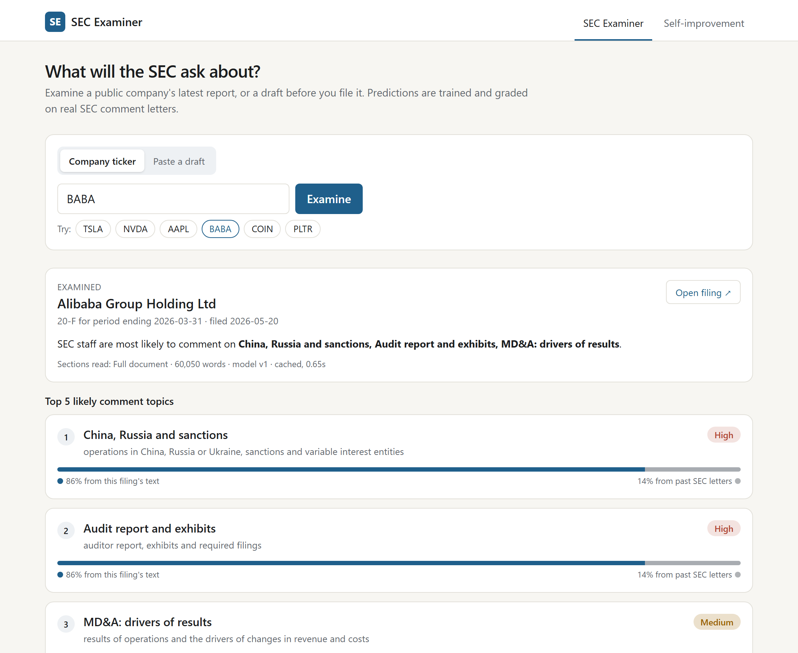
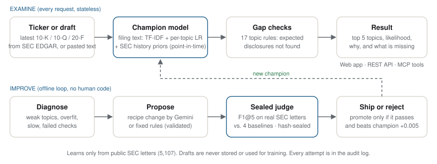
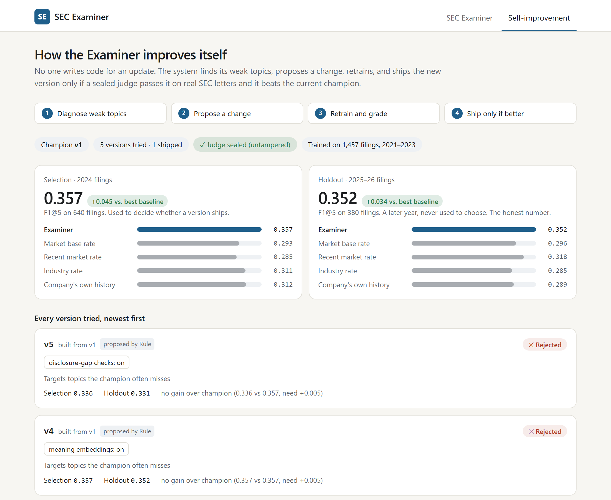

<p align="center"><picture><source media="(prefers-color-scheme: dark)" srcset="docs/img/wordmark-dark.svg"></picture></p>

<p align="center">Predicts what the SEC will ask about your 10-K, before the SEC&nbsp;does.</p>

<p align="center">
  
  
  
  
  
  
</p>

<p align="center">
<strong>Every year the SEC sends thousands of comment&nbsp;letters.</strong><br>
Each one costs a company weeks of lawyers, auditors and a public record of what it got&nbsp;wrong.
</p>

<p align="center">
<strong>5,107&nbsp;real SEC letters. 2,597&nbsp;reviewed filings. Tested on a year it never&nbsp;saw.</strong><br>
F1@5 of <strong>0.352</strong> on 380 filings from 2025–26, vs. 0.318 for the best simple&nbsp;baseline.
</p>

<p align="center">
<picture><source media="(prefers-color-scheme: dark)" srcset="docs/img/examiner-dark.png"></picture>
</p>

<p align="center"><sub>Alibaba's latest 20-F, examined in 8&nbsp;seconds. Every prediction says how much came from the filing and how much from SEC&nbsp;history.</sub></p>

<p align="center"><a href="https://sec-examiner-408632234593.us-central1.run.app"><strong>Try the live demo&nbsp;→</strong></a> · <a href="#your-turn">Run it yourself&nbsp;↓</a> · <a href="#how-it-improves-itself">See how it improves itself&nbsp;→</a> · <a href="#use-it-from-your-ai-assistant-mcp">Use it from Claude or Cursor&nbsp;→</a></p>

<br>

## Your turn

**Live demo:** <https://sec-examiner-408632234593.us-central1.run.app> — no sign-up. Each visitor gets **2 free examinations per day**; for unlimited use, run it on your machine:

Pick a company you know. If the Examiner's top topic matches the last letter the SEC sent them, you will see why this exists.

```bash
pip install -e .                      # Python 3.11+
uvicorn research_desk.api:app --port 8011
npm --prefix frontend install && npm --prefix frontend run dev -- -p 3011
```

Open <http://localhost:3011>, type a ticker (or click **TSLA**, **BABA**, **COIN**) and press **Examine**.

<p align="center"><sub>Local. Free. No account, no database, no API key needed to examine. Unlimited when you run it yourself.</sub></p>

## What the Examiner does for you

Give it a report. It tells you where the SEC is likely to push.

- **What will they ask about?** The 5 most likely comment topics (out of 23), each rated High, Medium or Lower.
- **Why?** Each topic shows how much came from your filing's own words and how much from what the SEC asked your company, your industry and the market before.
- **What is missing?** For 17 topics it checks the disclosures staff usually expect, e.g. goodwill without reporting-unit headroom, non-GAAP without the comparable GAAP measure.
- **Not filed yet?** Paste a draft. It is read in memory and forgotten.
- **Asked before?** It lists the company's recent SEC letters and what they were about.
- **How good is it, really?** The live dashboard shows the exact score on years it was never tuned on, next to the baselines it has to beat.

## What the Examiner will not do

- **Keep your draft.** Drafts are processed in memory. Nothing is written to disk, logged or used for training (a test checks this).
- **Learn from users.** It learns only from official SEC letters, so no user can poison it.
- **Ship a worse version.** A new version goes live only if a hash-sealed judge passes it and it beats the current champion. If the judge's files change, the dashboard shows it.
- **Grade itself on the past it trained on.** Every score is point-in-time: training uses only letters published before the graded filings.
- **Give legal advice.** It ranks likely topics from public data. Your counsel and auditors decide.

## Features

| Feature | Description |
| --- | --- |
| **Examine by ticker** | Fetches the company's latest 10-K, 10-Q or 20-F from SEC EDGAR, reads business, risk factors, MD&A and the notes, and ranks the 23 comment topics. 6–10 s first time, under 1 s after. |
| **Examine a draft** | Paste unfiled text with an optional industry (SIC) code. About 0.2 s. Warns when the text is too short to read reliably. |
| **Explanations** | Likelihood badge, the filing-vs-history split behind each score, and plain-English missing disclosures. |
| **Self-improvement loop** | Diagnoses weak topics, proposes a change (Gemini or fixed rules), retrains, and lets the judge decide. Rejected versions stay in the audit log. |
| **Sealed judge** | SHA-256 manifest over the grading code, 4 baselines, point-in-time history, minimum-gain and latency/cost gates. |
| **MCP server** | `examine_company`, `examine_draft`, `explain_topic`, `list_topics`, `examiner_status` for Claude, Cursor, VS Code or any MCP client. |
| **Code-writing loop** | `desk examiner-improve --code`: Gemini writes a Python feature function; a static safety check and an isolated sandbox run it; the judge decides. |
| **Usage limits and monitoring** | Public demo: 2 examinations per visitor IP per day, 300 site-wide, IPs kept only as daily-rotating hashes; `/api/metrics` shows requests, errors and p50/p95 latency; JSON request logs. |
| **REST API** | `GET /api/examiner/ticker/{ticker}`, `POST /api/examiner/draft`, `GET /api/examiner/status`. |

<details>
<summary><b>Everything else it does</b></summary>

| Feature | Description |
| --- | --- |
| **Corpus builder** | Pages EDGAR full-text search month by month, splits each letter into numbered comments, links it to the filing it reviewed, resumes after interruption. |
| **Topic taxonomy** | 23 deterministic topics with a follow-up-comment rule, so the gold labels cannot drift between runs. |
| **Version registry** | Every model version with its recipe, scores and parent; `desk examiner-rollback` restores the previous champion. |
| **Later-year holdout** | Train on 2021–23, choose on 2024, report on 2025–26. |
| **Predecessor entities** | Letters sent to a company's former legal entity count as its history (e.g. ExxonMobil). |
| **Dark mode and mobile** | Both pages work at phone width and follow the system theme. |

</details>

## How It Works

<p align="center"><picture><source media="(prefers-color-scheme: dark)" srcset="docs/img/how-it-works-dark.svg"></picture></p>

**The model.** For each topic, `score = w · P(topic | filing text) + (1 − w) · prior(topic | company, industry, recent market)`. The text side is TF-IDF with one logistic regression per topic; the prior side counts what the SEC asked before the filing date. `w` and every other setting live in a validated *recipe*, which is what the loop is allowed to change.

**The grade.** F1@5: of the real first-round comment topics in the SEC's letter, how many were in the Examiner's top 5, balanced against how many of its 5 were wrong.

## How it improves itself

<p align="center">
<picture><source media="(prefers-color-scheme: dark)" srcset="docs/img/loop-dark.png"></picture>
</p>

No one writes code for an update. Each run of `desk examiner-improve`:

1. **Diagnoses** the champion: topics with recall under 40%, validation that overstates real results, unused signals, slow training.
2. **Proposes** one recipe change. Gemini proposes from the diagnosis; fixed rules take over if it is offline or out of range. Nothing repeats.
3. **Retrains** on letters published before 2024 and grades on 2024 (selection) and 2025–26 (holdout).
4. **Ships** only if the judge passes it and it beats the champion by at least 0.005 on selection. The holdout is reported, never used to choose.

**It can also write code.** `desk examiner-improve --code` asks Gemini for a new `features(text)` Python function aimed at the weak topics. Before that code touches the model:

- a static check of its syntax tree allows only `re` and `math`, and blocks files, network, `eval`/`exec`, reflection, dunder attributes and format-string escapes (14 escape attempts are in the tests);
- it runs in a separate isolated interpreter (`python -I`, empty directory, no secrets, time limit), twice on a sample to prove it is deterministic, then on every filing;
- its features join the model as a recipe option, and the sealed judge decides like any other change. Rejected code stays on disk and in the audit log; only promoted code is ever served.

The honest record so far: 7 versions tried (2 of them written as code by the system), 1 shipped. Bigger vocabularies, meaning embeddings (local Ollama), hand-written disclosure-gap rules and two system-written code plugins were each tried and rejected because they did not beat v1. See [`docs/judge.md`](docs/judge.md) for every number.

| | Selection (2024, 640 filings) | Holdout (2025–26, 380 filings) |
| --- | --- | --- |
| **Examiner v1** | **0.357** | **0.352** |
| Company's own history | 0.312 | 0.289 |
| Industry rate | 0.311 | 0.285 |
| Recent market rate | 0.285 | 0.318 |
| Market base rate | 0.293 | 0.296 |

## Use it from your AI assistant (MCP)

The Examiner ships an MCP server, so Claude, Cursor or any MCP client can call it as tools.

```json
{
  "mcpServers": {
    "sec-examiner": {
      "command": "C:/path/to/02-ai-research-desk/.venv/Scripts/sec-examiner-mcp.exe"
    }
  }
}
```

Then ask: *"What is the SEC likely to ask Alibaba about in its next review?"* or *"Check this MD&A draft for gaps before we file."*

| Tool | What it returns |
| --- | --- |
| `examine_company(ticker)` | Top 5 topics with likelihood, filing-vs-history share, missing disclosures, past SEC letters |
| `examine_draft(text, sic?, form?)` | The same for unfiled text; never stored |
| `explain_topic(topic)` | What a topic covers and which disclosures staff expect |
| `list_topics()` | All 23 topics with plain-English names |
| `examiner_status()` | Champion, judge seal, selection and holdout scores, recent attempts |

## Quick Start

```bash
git clone <this repo> && cd 02-ai-research-desk
python -m venv .venv && . .venv/Scripts/activate      # macOS/Linux: . .venv/bin/activate
pip install -e ".[dev]"
cp .env.example .env              # set SEC_USER_AGENT to "<name> <email>" (SEC asks for one)
pytest -q                         # 129 tests
```

<details>
<summary><b>Rebuild the data and the model from scratch</b></summary>

```bash
desk examiner-build --start 2022-01-01 --end 2026-10-31   # SEC letters (resumable, ~2 h)
desk examiner-fetch                                        # the filings they reviewed
desk judge-baselines                                       # what any model must beat
desk examiner-improve --iterations 3                       # bootstrap + self-improvement
desk examiner-status                                       # champion, lineage, attempts
desk examiner-rollback                                     # revert to the previous champion
```

Proposals from Gemini need `LLM_API_KEY` (Google AI Studio free tier) in `.env`; without it the loop uses its fixed rules. Optional embeddings need [Ollama](https://ollama.com) with `nomic-embed-text`.

</details>

## Project Structure

```text
src/research_desk/
├── examiner/
│   ├── letters.py       # EDGAR full-text search, letter parsing, comment splitting
│   ├── link.py          # letter -> the 10-K/10-Q/20-F it reviewed
│   ├── corpus.py        # append-only, resumable corpus build
│   ├── filings.py       # fetch and cache the reviewed filings' sections
│   ├── model.py         # Recipe, priors, the Examiner, training and tuning
│   ├── gaps.py          # 17 expected-disclosure rules
│   ├── embed.py         # optional local embeddings (Ollama)
│   ├── run.py           # train + grade with the judge (selection / holdout)
│   ├── improve.py       # diagnose -> propose -> train -> judge -> ship/reject, registry, audit log
│   ├── plugins.py       # system-written feature code: safety check, sandbox, cache
│   ├── plugin_runner.py # the isolated interpreter's entry point
│   ├── limits.py        # per-IP daily quota and request metrics (public demo)
│   ├── service.py       # stateless product service (ticker, draft, status)
│   └── mcp_server.py    # MCP tools
├── judge/               # hash-sealed: topics, cases, scoring, baselines, harness, gates.json
├── api.py               # FastAPI
└── cli.py               # `desk` commands
frontend/src/app/
├── examiner/            # the Examiner page
└── loop/                # the self-improvement dashboard
docs/judge.md            # judge rules, corpus stats, every version's numbers
```

## Tech Stack

| Layer | Tools |
| --- | --- |
| Model | scikit-learn (TF-IDF, logistic regression), NumPy, joblib |
| Data | SEC EDGAR (submissions, full-text search, filing archives), httpx |
| Self-improvement | Gemini via Google AI Studio (OpenAI-compatible), rule fallback, optional Ollama embeddings |
| Backend | FastAPI, Pydantic |
| Frontend | Next.js 15, React 19, Tailwind CSS 4 |
| Integration | Model Context Protocol (Python SDK) |
| Quality | pytest (129 tests), ruff, ESLint, TypeScript |

## FAQ

**Is 0.35 good?** For a top-5 ranking over 23 topics on real letters, the bar is the baselines: the best one scores 0.318 on the holdout. The Examiner beats every baseline on both windows, and its holdout score (0.352) is close to its selection score (0.357), so it is not overfitted to the year it was chosen on.

**Why do MD&A, non-GAAP and segments show up so often?** They are the SEC's most common comment topics. Company-specific topics rise when the filing gives a reason: China and sanctions for Alibaba, climate for energy companies, financial instruments for banks.

**Why not use an LLM to read the whole filing?** Cost and honesty. The current model runs in milliseconds on a laptop and every change is graded on 1,000+ real cases. An LLM reader is a candidate the loop can test next; it ships only if it wins.

**Why only 2 checks on the live demo?** It runs on a small budget with no accounts. Run it locally (Quick Start) for unlimited use, the full CLI and the MCP server.

**Does any of my data leave my machine?** Ticker lookups call SEC EDGAR. Drafts never leave the process. The improvement loop sends only aggregate diagnostics (per-topic recall, recipe) to Gemini, never filing text or drafts.

**What are the known limits?** Some bank 10-Qs are not fully split into sections; topics with few past letters (crypto, mining) have little to learn from; the first lookup of a ticker takes 6–10 s because the filing is downloaded live.

## Disclaimer

The SEC Examiner ranks likely comment topics from public SEC data. It is not legal, accounting or investment advice and is not affiliated with or endorsed by the U.S. Securities and Exchange Commission. Use it to prepare, then decide with your counsel and auditors.

## About the Author

Built by [@sivram04](https://github.com/sivram04) as part of an AI engineering portfolio: an enterprise-style product whose model improves itself without anyone writing code, and proves each step on real data.
